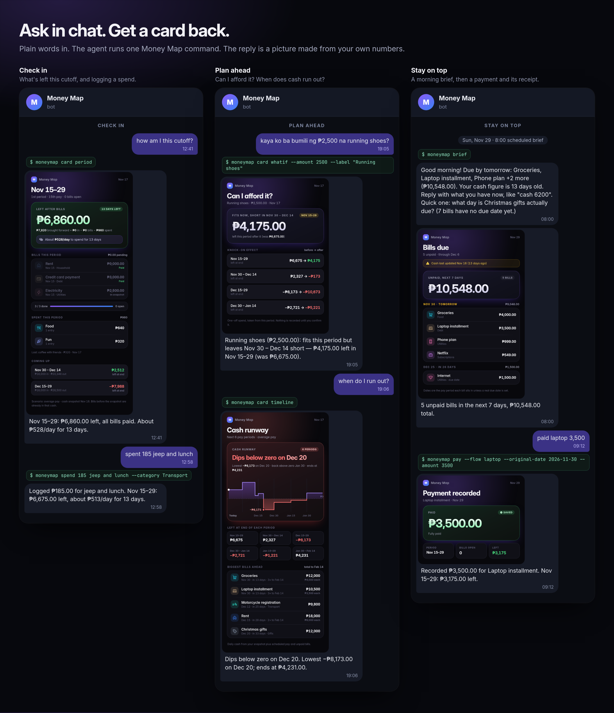
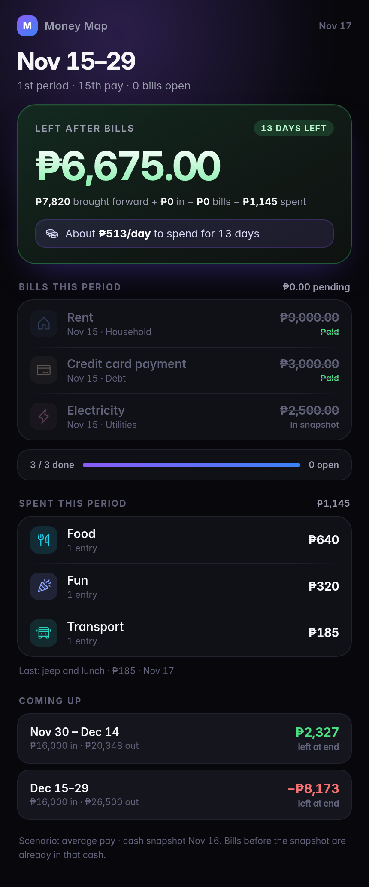
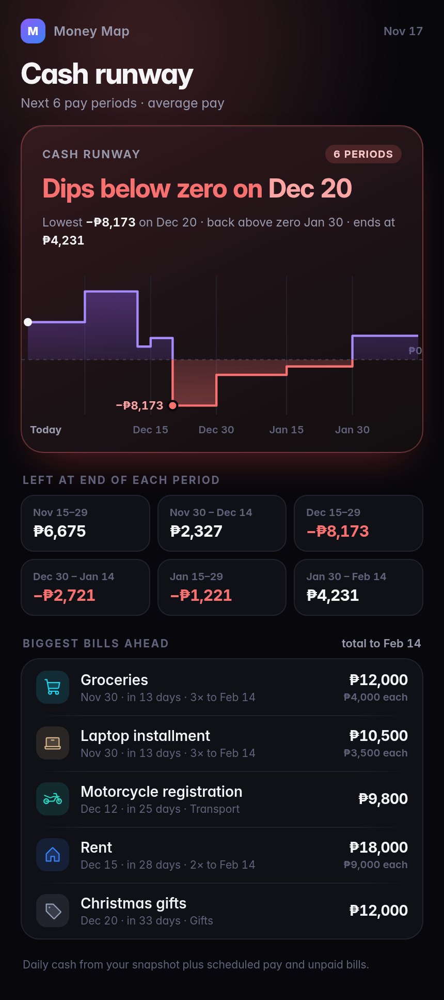
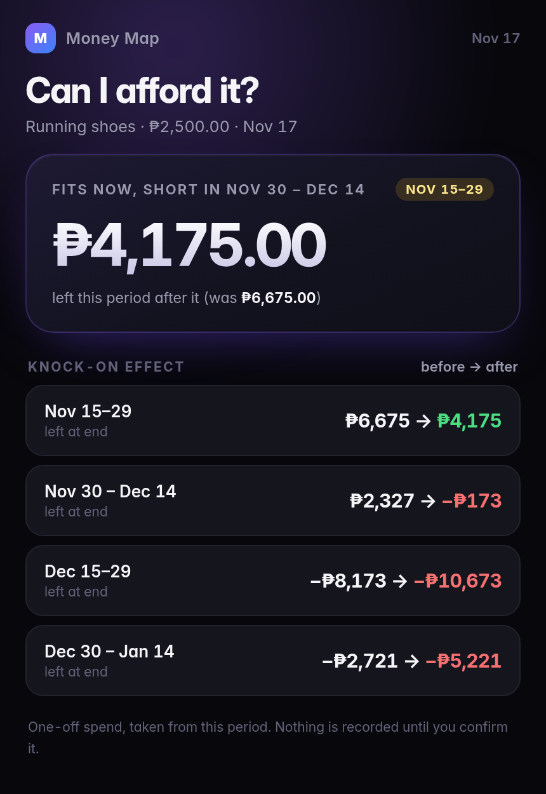
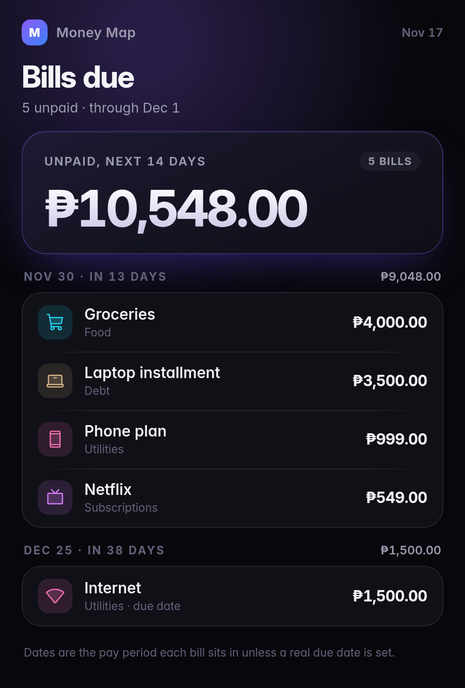
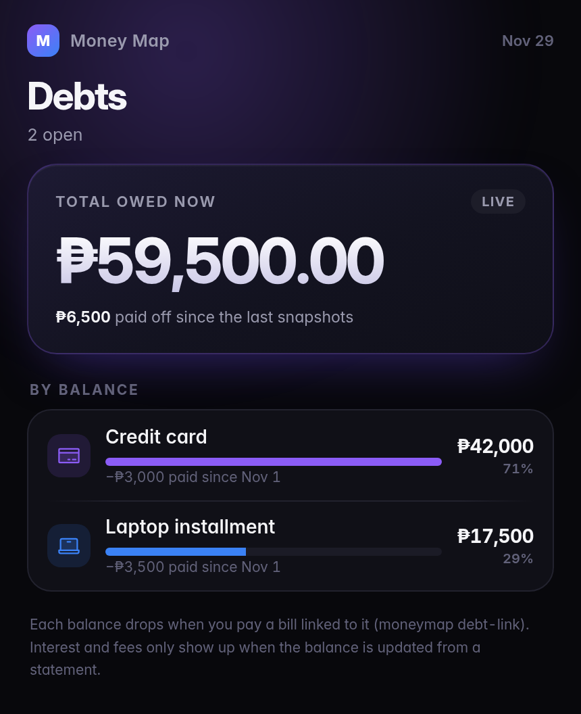
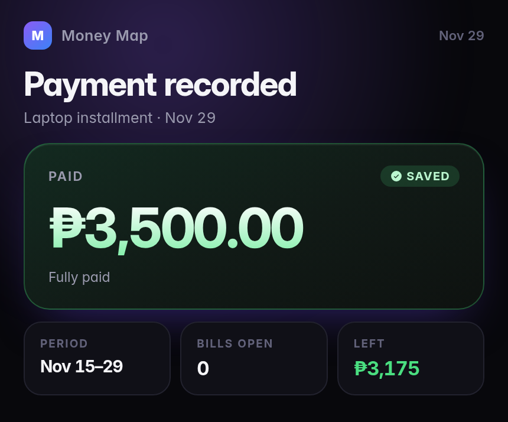

# Money Map

**A budget you talk to.** Message it like a friend ("how am I this cutoff?", "spent 185 jeep",
"kaya ko ba bumili ng ₱2,500 shoes?") and it answers with a card built from your own numbers.



<sub>Sample data. Every number, reply and card above is real output from `python3 tools/demo.py`.</sub>

## How a message becomes a card

```text
"kaya ko ba bumili ng ₱2,500 na running shoes?"
        │  the AI agent picks ONE command (it never does the maths)
        ▼
moneymap card whatif --amount 2500 --label "Running shoes"
        │  the engine works out this period and the next ones from SQLite
        ▼
Running shoes (₱2,500.00): fits this period but leaves Nov 30 – Dec 14 short
MEDIA:/tmp/moneymap/whatif.png      ← caption + picture go back to the chat
```

The agent (Hermes or DeepSeek) only translates words into a short list of fixed commands. The
**engine** knows pay periods, bills, payments, spending and debts. The **cards** are HTML templates
rendered to PNG by headless Chromium. Because the model never touches the numbers, a cheap model is enough.

## Try it (no setup, sample data)

```bash
git clone https://github.com/light691/money-map && cd money-map
python3 tools/demo.py --out /tmp/mm      # builds a sample budget and renders every image here
```

Here are the same commands run against that demo budget on Nov 17, someone paid ₱16,000 on the 15th and 30th.
(`python3 tools/moneymap.py seed` gives you a smaller sample to play with.)

```console
$ python3 tools/moneymap.py spend 185 jeep and lunch --category Transport
Logged ₱185.00 for jeep and lunch. Nov 15–29: ₱6,675.00 left, about ₱513/day for 13 days.

$ python3 tools/moneymap.py timeline --periods 4
period                      in         out         net          left
Nov 15–29                 0.00        0.00   -1,145.00      6,675.00
Nov 30 – Dec 14      16,000.00   20,348.00   -4,348.00      2,327.00
Dec 15–29            16,000.00   26,500.00  -10,500.00     -8,173.00
Dec 30 – Jan 14      16,000.00   10,548.00    5,452.00     -2,721.00

$ python3 tools/moneymap.py card timeline
Dips below zero on Dec 20. Lowest −₱8,173.00 on Dec 20; ends at ₱4,231.00.
MEDIA:/tmp/moneymap/timeline.png
```

Needs Python 3.12+ and Chromium (for the pictures). No pip installs. `python3 -m unittest discover -s tests` runs the 47 tests.

## The cards

| This cutoff | Cash runway | Can I afford it? |
|:---:|:---:|:---:|
|  |  |  |
| What's left after bills and spending, and a daily amount to stay on track. | Cash day by day for 6 pay periods, the date it dips below zero, and the bills that cause it. | The effect on this period *and* the next ones, not just yes or no. |

| Bills due | Debts | Payment receipt |
|:---:|:---:|:---:|
|  |  |  |
| Unpaid bills by date, with real due days kept apart from each bill's cutoff. | Live balances: each paid bill lowers the debt it's linked to. | Instant proof after "paid laptop 3,500", with what's left. |

## What it understands

| You say | It runs | You get |
|---|---|---|
| "how am I this cutoff?" | `card period` | the period card |
| "spent 185 jeep and lunch" | `spend 185 jeep and lunch --category Transport` | one line: what's left and per day |
| "I have 6,200 now" | `cash 6200` | new baseline; anything unpaid gets flagged |
| "paid Meralco 2,380" | `pay --flow electric ... --amount 2380` | receipt card |
| "kaya ko ba ₱2,500 shoes?" | `card whatif --amount 2500` | what-if card |
| "when do I run out?" | `card timeline` | runway card |
| "Meralco is due on the 20th" | `due electric 20` | one line |
| (8:00 every day) | `brief` | a card only on paydays, bills due, short periods or old cash. Quiet days stay quiet |

## Under the hood

- **Pay periods from your paydays.** Works with 10th/25th, 15th/30th or monthly; the 30th lands on Feb 28 in February.
- **Cash snapshot.** "I have ₱6,200 now" is the baseline. Payments after it come out of cash, and `undo` puts them back.
- **Icons with meaning.** 1,400+ [Phosphor](https://phosphoricons.com) icons are matched from plain words, local ones included (Meralco → ⚡, jeepney → 🚌). Colour marks the category. Red, green and amber only ever mean status.
- **Multi-user beta.** An invite-only Telegram bot on DeepSeek, with one SQLite file per person. The model can only call a fixed tool list: no shell, and every argument is checked. Each person has a daily message limit, `/delete` erases everything, and web login uses one-time links.
- **Ops.** Nightly backups, systemd units in `deploy/`, and a stale-write guard so the web app and the agent never overwrite each other.

<details>
<summary><b>All commands</b></summary>

| Command | What it does |
|---|---|
| `period`, `timeline`, `upcoming` (`--json`) | Engine output for agents and scripts |
| `card <period\|bills\|timeline\|whatif\|receipt\|debts\|icons>` | PNG + caption, printed as `MEDIA:<path>` |
| `cash N` | Cash on hand now |
| `spend N note --category X`, `spends`, `spend-rm ID` | Everyday spending |
| `pay --flow ID --original-date D --amount N`, `undo ID` | Bill payments |
| `flow-add`, `flow-set`, `flow-rm`, `override` | Bills and income |
| `due ID DAY`, `due` | Real due days, or list the bills missing one |
| `balance-add`, `debt-link ID DEBT`, `debt-link` | Debts and live balances |
| `paydays 15,30`, `setup --paydays --pay --cash` | Pay schedule, first-run setup |
| `icon find\|set\|reset\|list\|auto` | Icons |
| `brief` | Morning message (prints nothing on quiet days) |
| `backup` | Copies of every database |

</details>

<details>
<summary><b>Run the bot for friends</b></summary>

```bash
cp deploy/*.service deploy/*.timer ~/.config/systemd/user/
$EDITOR ~/.config/money-map/bot.env   # TELEGRAM_BOT_TOKEN, DEEPSEEK_API_KEY, MONEYMAP_PUBLIC_URL
systemctl --user enable --now money-map-bot.service money-map-public.service money-map-backup.timer
python3 tools/bot.py invite -n 3      # one-time invite codes
```

`server.py --public` serves only people signed in through the bot, and each person sees only their own
database. Put it behind HTTPS, and tell people their messages go to the model provider.

</details>

```
tools/moneymap.py  engine + CLI        tools/cards.py   card templates + renderer
tools/icons.py     icon search          tools/bot.py     multi-user Telegram bot
tools/server.py    web app + sync API   tools/demo.py    rebuilds every image in this README
```

Icons: [Phosphor](https://phosphoricons.com) (MIT). Font: [Inter](https://rsms.me/inter/) (OFL).
